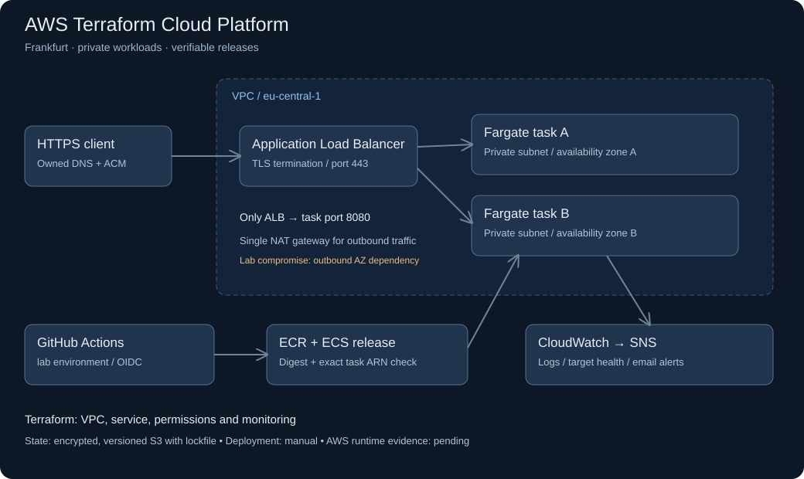

# AWS Terraform Cloud Platform

[](https://github.com/dhanraj002/aws-terraform-cloud-platform/actions/workflows/ci.yml)

A small AWS delivery platform for testing one operational question: **did the new release succeed, or did the service quietly recover by rolling back?**

The workload is intentionally small: a Python release probe with separate liveness and readiness endpoints. The engineering work is in the infrastructure, permissions, deployment checks, and recovery procedure.

## Architecture



## What is implemented

- Reusable networking and service modules; two availability zones, private tasks, HTTPS ingress, and security-group references.
- Separate bootstrap stack for remote state, ECR and a GitHub OIDC deployment role. The application task has no AWS API permissions.
- A manual release workflow that builds an image, runs a container check, pushes to ECR, and deploys by digest.
- Release verification against the exact task-definition ARN. Healthy rollback is a failed release, not a green pipeline.
- A controlled readiness failure, CloudWatch alarms, dashboard, and recovery runbook.
- A Terraform-plan tag check scoped to customer-managed resource types, avoiding blanket assumptions about service-created resources.

**Verification status:** see [validation](docs/validation.md) for checks actually run. Cloud deployment and AWS rollback timings are not claimed until a live drill is recorded. This repository is a portfolio lab, not a description of an employer's infrastructure.

## Start locally — no AWS account needed

Requires Python 3.13+; application and tests use the standard library.

```bash
python3 -m unittest discover -s tests -v
python3 -m app.server
# From another terminal:
curl http://localhost:8080/
curl http://localhost:8080/readyz
```

To reproduce an unhealthy candidate locally:

```bash
FAIL_READINESS=true PORT=8081 python3 -m app.server
# /readyz returns 503; /healthz still returns 200
```

For Docker:

```bash
docker build -t release-probe:local .
docker run --rm --read-only --cap-drop ALL --security-opt no-new-privileges -p 127.0.0.1:8080:8080 release-probe:local
```

## Deploy and operate

1. Read the [design decisions and limits](docs/design-decisions.md).
2. Follow the [bootstrap and deployment guide](docs/deployment.md).
3. Run the [failure and recovery drill](docs/runbook.md).
4. Review [cost and cleanup](docs/cost-and-cleanup.md) before leaving resources running.

Publishing or pushing to this repository runs validation only. AWS deployment is manual and needs account-specific configuration. There is no automatic `terraform apply`.

## Repository map

| Path | Responsibility |
|---|---|
| `infra/bootstrap` | State bucket, image registry, OIDC role |
| `infra/modules/network` | Subnets, routes, NAT and VPC |
| `infra/modules/service` | ECS, ALB, task permissions and monitoring |
| `scripts/deploy.py` | Candidate task registration and release verification |
| `scripts/check_plan.py` | Required tags on Terraform-managed resources |
| `tests` | HTTP behavior, deployment safety and policy tests |
| `docs` | Setup, tradeoffs, failure exercise and evidence |

## Next improvements

- Run the first AWS drill and record actual recovery time and resource cost.
- Add a real application workload before selecting persistence, autoscaling or a business SLO.
- Evaluate VPC endpoints versus NAT using measured traffic and regional prices.
- Add image vulnerability gating and signed provenance before using this for sensitive workloads.

Maintained by [Dhanraj Kumar](https://github.com/dhanraj002).
